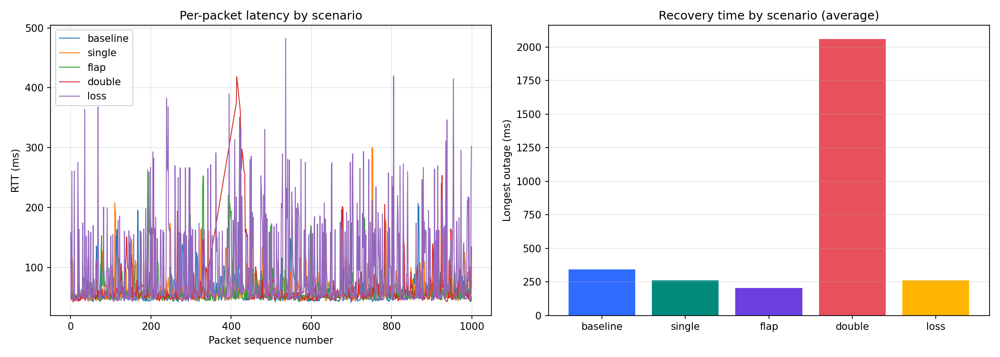

# Adaptive Communication Network with Failure Recovery

SDN-Socket Programming, Jackfruit Mini Project (Project #30, UDP).

A UDP client/server application runs over a Mininet network controlled by a Ryu SDN controller. When a link fails, the controller detects it through an OpenFlow `PortStatus` event and moves traffic to a backup path, while the client's own retransmission logic repairs the packets lost during the switch-over.

## Architecture

```
                 Ryu controller (controller.py, OpenFlow 1.3, port 6653)
                      :  control channel (dashed)
 h1 ---- s1 ----+---- s2 ----+---- s4 ---- h2        primary path: s1-s2-s4
 client         |            |       server
                +---- s3 ----+                       backup path:  s1-s3-s4
```

- Hosts: h1 `10.0.0.1` (UDP client), h2 `10.0.0.2` (UDP echo server, port 5005)
- Four Open vSwitch switches speaking OpenFlow 1.3; every link has 5 ms delay (TCLink)
- Two disjoint paths between s1 and s4

## Files

| File | Purpose |
|---|---|
| `topo.py` | Builds the Mininet topology, connects to the remote controller, runs a test scenario (`baseline`, `static`, `single`, `flap`, `double`, `loss`) |
| `controller.py` | Ryu app: installs primary-path flows, reacts to `PortStatus`, reroutes, polls flow stats every 2 s. With `STATIC=1` it logs failures but does not reroute (the no-SDN-reaction baseline) |
| `client.py` | UDP client: 1000 packets, one every 20 ms, 100 ms retransmit timeout, up to 3 retries; writes `results_<scenario>.csv` and appends to `summary.csv` |
| `server.py` | UDP echo server on port 5005 |
| `analyze.py` | Builds `comparison.md` and `latency_comparison.png` from `summary.csv` |
| `d2_controller_*.log` | Controller log of each scenario |

## How the recovery works

1. The client sends numbered UDP packets and waits for the echo.
2. A link fails; the switch sends an OpenFlow `PortStatus` message.
3. The controller marks the port down and logs `LINK DOWN`.
4. It picks the first healthy path (`path_ok`), deletes old flows and installs the new ones (`REROUTE primary -> backup`, about 1 ms).
5. Packets sent during the switch-over can be lost; the client retransmits after 100 ms. After 3 failed retries a packet is counted as lost.
6. When a link returns, the controller switches back automatically. If no path is healthy, flows are removed (`None`) until one returns.

## How to run

Three terminals, all in `~/sdn_project`. The controller must start before Mininet.

```bash
# T2: clean up first (this also kills any running controller)
sudo mn -c

# T1: controller (Ryu is installed in the sdn-venv311 virtual environment)
source ~/sdn-venv311/bin/activate
cd ~/sdn_project
ryu-manager controller.py --verbose 2>&1 | tee d2_controller_single.log
# for the static baseline, start it as:  STATIC=1 ryu-manager controller.py --verbose

# T3: confirm the controller is listening
sudo ss -ltnp | grep 6653

# T2: run one scenario: baseline | static | single | flap | double | loss
sudo python3 topo.py single

# T3: proof
sudo ovs-ofctl -O OpenFlow13 dump-flows s1
python3 analyze.py
```

Flow-table proof: before the failure `s1` forwards `in_port=s1-eth1` to `output:s1-eth2` (primary); during the failure it forwards to `output:s1-eth3` (backup).

## Test cases

| # | Scenario | What is done | Expected | Actual |
|---|---|---|---|---|
| 1 | `baseline` | No failure | No loss | 0% loss |
| 2 | `static` | s1-s2 down at 5 s, up at 13 s, controller does NOT reroute | Traffic is lost for the whole outage | 38.9% loss, 8158 ms outage |
| 3 | `single` | Same failure, controller reroutes | Reroute to backup, then back, no loss | 0% loss, 81 ms outage |
| 4 | `flap` | s1-s2 down/up three times (4-14 s) | Controller stays stable | 0% loss, 3 reroute pairs |
| 5 | `double` | s1-s2 down at 4 s, s1-s3 down at 7 s (both paths dead), s1-s3 up at 9 s, s1-s2 up at 12 s | Loss while no path exists, automatic recovery | 8.7% loss, recovered by itself |
| 6 | `loss` | 3% random loss on every link, plus the single failure | Retries absorb the loss | 0.2% loss |

Controller log for `double` (automatic recovery from a total outage):
`primary -> backup` then `backup -> None` then `None -> backup` then `backup -> primary`.

## Results

1000 packets per run. Outage is the longest gap between two received packets (recovery time).

| Scenario | Runs | Loss % | Retransmitted | Avg latency ms | Max latency ms | Outage ms |
|---|---|---|---|---|---|---|
| baseline | 1 | 0.0 | 18 | 58.4 | 277 | 210 |
| static | 1 | 38.9 | 27 | 62.7 | 398 | 8158 |
| single | 1 | 0.0 | 4 | 53.0 | 153 | 81 |
| flap | 1 | 0.0 | 30 | 56.2 | 178 | 119 |
| double | 1 | 8.7 | 23 | 57.3 | 406 | 2119 |
| loss | 1 | 0.2 | 229 | 80.6 | 387 | 101 |



## Analysis

- **SDN rerouting versus a static network.** The same 8-second link failure caused 38.9% packet loss and an 8158 ms outage when the controller did not react (`static`), but 0% loss and an 81 ms outage when it rerouted (`single`).
- **Robustness.** Three consecutive failures (`flap`) caused no loss. When both paths were down (`double`), 8.7% of packets were lost during the roughly 2 s with no route, and the network recovered by itself when a link returned. With 3% random loss on every link plus a failure (`loss`), the client's retries recovered all but 0.2% of packets.
- **Recovery time is mostly the client timer.** The controller reroutes in about 1 ms. The rest of the outage is packets lost on the dead path plus the 100 ms retransmit timeout.
- **Timing varies between runs in the VM.** Baseline retransmits some packets even with no failure, because the round trip (about 40 ms) plus VM jitter sometimes passes the 100 ms timeout. Loss percentage is the most reliable metric; individual latency and outage values should be read as approximate.

## Limitations and future work

- Fixed two-path design; paths are hard-coded rather than computed from the topology.
- Failure detection relies on OpenFlow `PortStatus`; active probing (LLDP/BFD) would also catch silent failures.
- Single controller, which is a single point of failure.
- A fixed 100 ms retransmit timeout; an adaptive timeout based on measured RTT would reduce spurious retransmits.
- One run per scenario in the final table, on a single VM; more repetitions would tighten the numbers.
